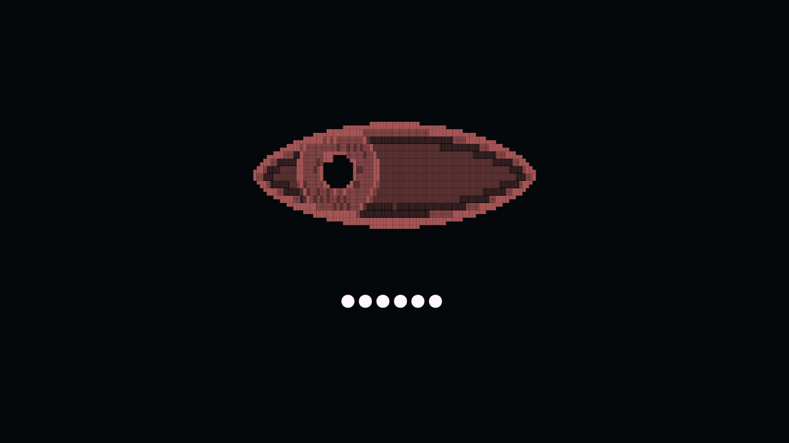

# Watchful Eye

A block-character surveillance eye for the Omarchy lock screen. The iris follows
the pointer, with a dark pupil, a bright reflection, and shaded lids. The password
field is invisible at rest; typing reveals large, bright dots.



## Requirements

- Omarchy **4.0.4**, with its Quickshell lock service and Lua Hyprland setup.
- The standard Omarchy password PAM configuration. Fingerprint authentication
  remains available when configured; the visual fingerprint hint is hidden.
- No additional runtime packages or network services. The renderer uses Qt Quick
  and the system monospace font.

Version 0.1.0 contains a snapshot of the Omarchy 4.0.4 lock service. Other versions
are not yet verified. This is a replacement lock plugin, rather than a wallpaper
or a screen overlay.

## Install

Install without enabling first:

```bash
omarchy plugin add https://github.com/brunoaureli/omarchy-watchful-eye.git
~/.config/omarchy/plugins/io.github.brunoaureli.watchful-eye/watchful-eye check
```

When prompted during installation, leave it disabled until the compatibility
check passes. Then, from an **unlocked desktop**, enable it:

```bash
omarchy plugin enable io.github.brunoaureli.watchful-eye
```

Omarchy recognizes this as a clone of `omarchy.lock`: enabling it switches off the
built-in service, and disabling it restores the built-in service. If another
custom lock plugin is enabled, disable that custom lock before enabling this one.

For the original local prototype, that means:

```bash
omarchy plugin disable bruno.lock
omarchy plugin enable io.github.brunoaureli.watchful-eye
```

The plugin does not run an installer, write your Hyprland settings, or configure
PAM. Omarchy's explicit enable/disable commands manage the plugin selection.

## Preview and use

```bash
~/.config/omarchy/plugins/io.github.brunoaureli.watchful-eye/watchful-eye preview
```

**Preview is not a lock screen.** It is labeled `PREVIEW`, accepts no password,
and closes when you click its background or press Escape. The pointer-following
eye works in preview, too. Do not use preview to test password authentication.

Lock normally with **Super+Ctrl+L** or:

```bash
omarchy system lock
```

Move the pointer to look around. Type your password and press Enter to unlock.
The empty field has no prompt, outline, background, caret or fingerprint icon.
Failures still display the original authentication error message. Escape or
Ctrl+U clears typed text. Long passwords reduce the dot size to stay inside the
field.

## Customize

- `Eye.js`: block raster, shading, pupil size and gaze limits.
- `AsciiEye.qml`: responsive grid sizing and gaze easing (140 ms).
- `LockView.qml`: eye placement, theme accent and password-dot appearance.

The eye uses the current theme's bar accent. Password dots are near-white,
34-pixel glyphs at their largest size. Gaze is bounded and clipped to the eye.
Only pointer movement animates the eye; it has no idle animation or polling loop.

Back up local edits before updating a git-managed plugin. Authentication and
preview handling belong in `Service.qml`; cosmetic edits should stay in the
three presentation files above.

## Disable or remove

From an unlocked desktop:

```bash
omarchy plugin disable io.github.brunoaureli.watchful-eye
```

This restores the original Omarchy lock screen. To uninstall the files too:

```bash
omarchy plugin remove io.github.brunoaureli.watchful-eye
```

If a preview is covering the desktop, click its background, press Escape, or run
`omarchy-shell lock hidePreview`. A preview never validates a password.

If you need to restore the built-in lock configuration from a logged-in TTY:

```bash
omarchy plugin disable io.github.brunoaureli.watchful-eye
omarchy plugin enable omarchy.lock
```

If IPC is unavailable, edit `~/.config/omarchy/shell.json`: remove this plugin's
entry from `plugins`, remove `omarchy.lock` from `disabledPlugins`, and add
`io.github.brunoaureli.watchful-eye` to `disabledPlugins`. An already active secure
lock may keep its current client until it is unlocked. `omarchy restart shell`
also deliberately refuses to restart a healthy active lock. These instructions
restore configuration; they do not bypass authentication or promise to dismiss
an existing secure lock.

## What is preserved

The lock lifecycle and password/fingerprint PAM flows are copied from the stock
Omarchy 4.0.4 service. The only service changes concern the visual preview:
pointer forwarding, an explicit preview label, and Escape dismissal.

No password is written to a file, logged or sent over the network by this plugin.
Passwords are handled by the stock Omarchy in-memory authentication flow. The
plugin declares the `authentication` capability because it replaces that service.
It should be reviewed as authentication-capable code, not as an isolated picture.

See [UPSTREAM.md](UPSTREAM.md) for attribution and the baseline checks.

## Tests

Renderer and authentication-contract tests need Node.js 22 or newer:

```bash
npm test
```

On a machine with Omarchy, Quickshell and Qt's QML test module installed:

```bash
python3 tests/interaction.py
```

That test runs an offscreen lock **view**, moves the pointer in both the normal
and preview-layer layouts, types synthetic characters, checks masking and Enter
submission, and checks Ctrl+U. It never starts the lock service, acquires a session
lock or calls PAM. It uses a temporary HOME and runtime directory.

Generate the screenshot with:

```bash
python3 tests/interaction.py --preview preview.png
```

The screenshot uses synthetic dots and a fixed theme fixture. Headless checks
cover rendering and event handoff; real Wayland lock acquisition, PAM success,
fingerprint hardware, multi-monitor use and suspend/resume still require testing
on the target machine. Keep a logged-in TTY available for the first real lock test.

## License

MIT. The original artwork and presentation changes are by brunoaureli. The lock
service and base view derive from Omarchy, copyright David Heinemeier Hansson.
This project is not an official Omarchy component.
